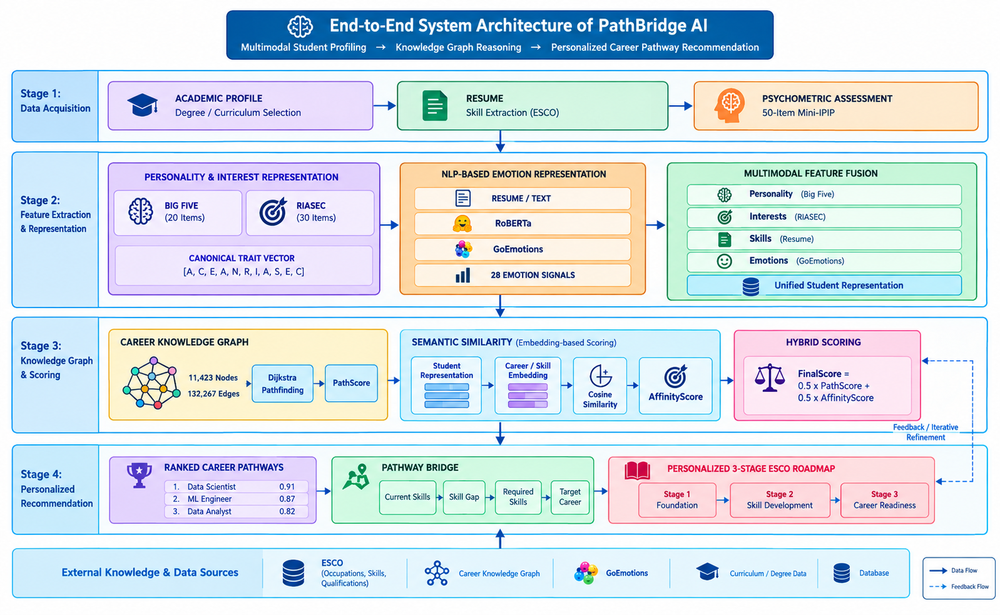
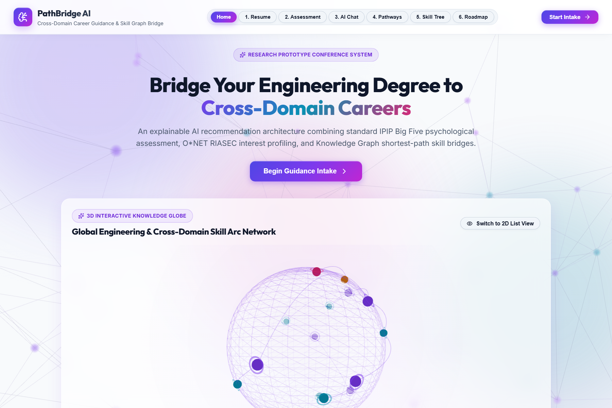
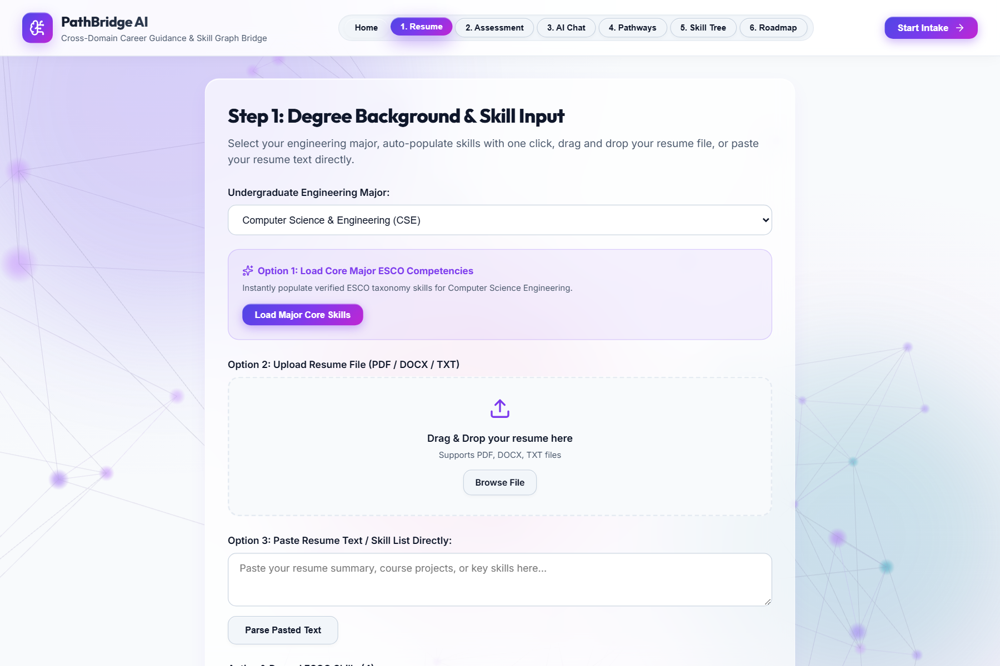
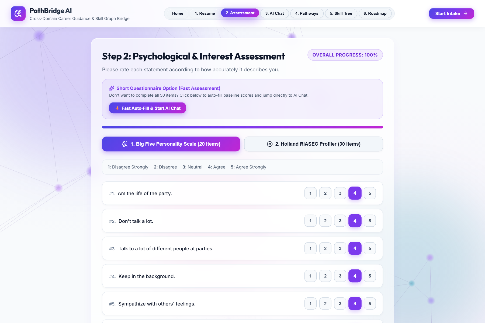
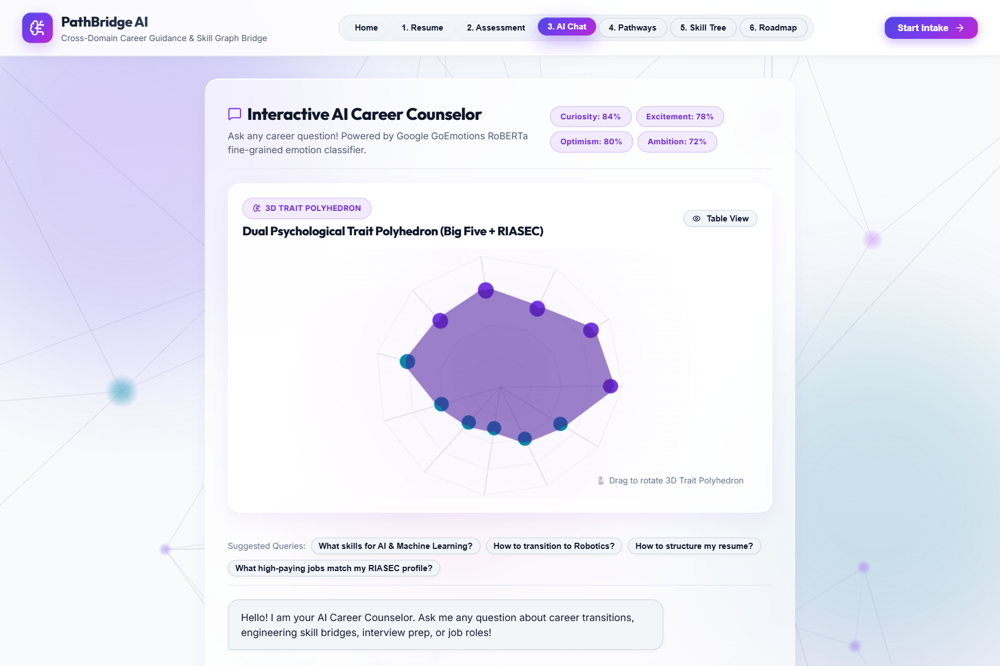
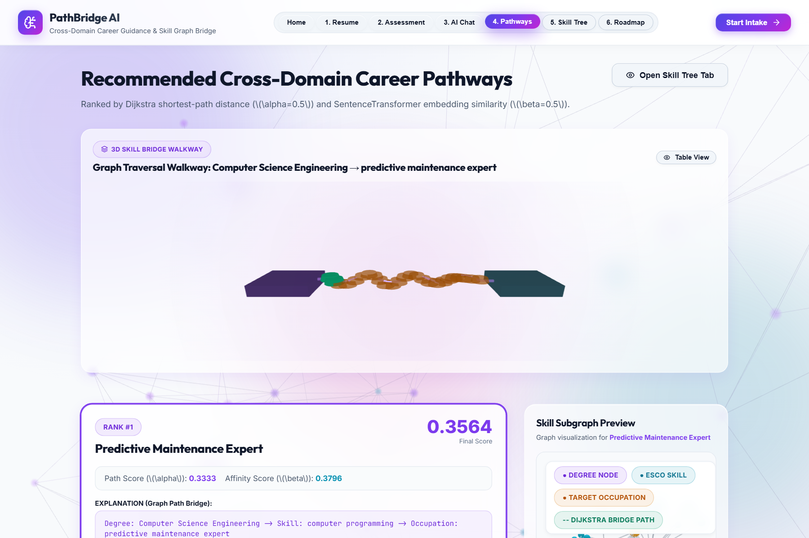
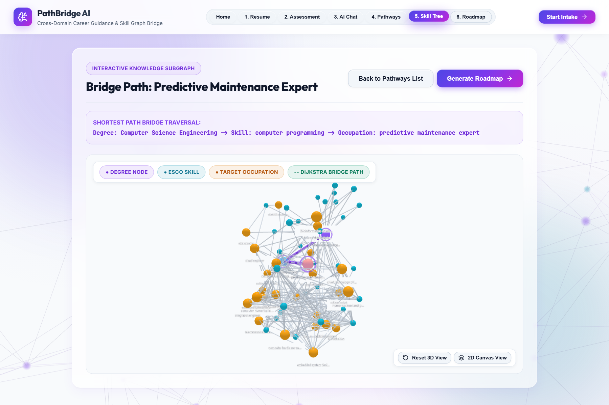
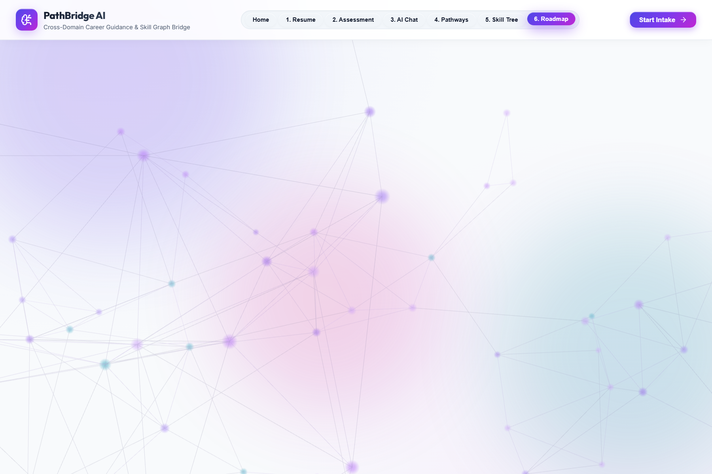

# PathBridge AI: Knowledge-Graph-Driven Personalized Career Guidance System

[](https://www.python.org/)
[](https://fastapi.tiangolo.com/)
[](https://react.dev/)
[](https://threejs.org/)
[](LICENSE)

**PathBridge AI** is an explainable, graph-augmented AI decision-support architecture designed to guide undergraduate engineering students and early-career professionals through cross-domain career transitions.

Unlike traditional "black-box" recommender systems, PathBridge AI guarantees **100% explainability** by grounding every career recommendation in an explicit **Knowledge Graph shortest-path traversal** over 17,423 ESCO/O*NET nodes and 132,267 transferability edges. It pairs psychological trait vectors (20-item Mini-IPIP Big Five + 30-item O*NET Mini-IP) with emotion signals extracted via a **pretrained RoBERTa GoEmotions classifier** (`SamLowe/roberta-base-go_emotions`), scoring prospective career destinations via a hybrid Dijkstra-Embedding algorithm ($\alpha=0.5, \beta=0.5$).

---

## 🌟 Key Features

- 🧠 **Multi-Domain Knowledge Graph**: Fuses ESCO v1.1.1, O*NET 31.0, and 14 ABET-aligned engineering curricula into a heterogeneous NetworkX graph (13,486 skill nodes, 3,923 occupation nodes, 14 degree nodes, 132,267 transferability edges).
- 📋 **Shortened 50-Item Psychometric Intake**: Replaces fatigue-inducing 110-item surveys with validated 20-item Mini-IPIP Big Five and 30-item O*NET Mini-IP profilers.
- 🎭 **Emotion Signal Extraction**: Captures fine-grained affective signals (e.g. curiosity, optimism, ambition) from student text responses using pretrained RoBERTa GoEmotions NLP.
- ⚡ **Hybrid Dijkstra + SBERT Scoring Engine**: Combines structural shortest-path graph proximity ($S_{\text{path}}$) with dense SBERT embedding semantic affinity ($S_{\text{affinity}}$).
- 🎨 **Cinematic Light Theme UI & Signature 3D WebGL Modules**: Features Three.js WebGL interactive canvases (`KnowledgeGlobe3D`, `PathwayBridge3D`, `TraitRadar3D`, `RoadmapTimeline3D`) with 2D/Table accessibility toggles and 45 FPS throttling.
- 🗺️ **ESCO-Linked 3-Stage Transition Roadmap**: Synthesizes custom, 3-stage action plans (Immediate, Mid-Term, Post-Graduation) linked directly to official European ESCO qualification URIs.

---

## 🏛️ End-to-End System Architecture

The core pipeline integrates psychometric trait profiling, conversational emotion extraction, cross-domain Knowledge Graph path traversal, and multi-tier roadmap synthesis into a unified, explainable decision support architecture:

<p align="center">
  
</p>

---

## 📸 Application Interface & Interactive Tabs

| 1. Landing & 3D Knowledge Globe | 2. Resume & Skill Extraction |
| :---: | :---: |
|  |  |
| **Interactive 3D Knowledge Globe & Intake** | **Automated Parsing & ESCO Skill Tagging** |

| 3. Psychometric Trait Assessment | 4. RoBERTa Emotion-Aware AI Counselor |
| :---: | :---: |
|  |  |
| **Mini-IPIP Big Five & O*NET RIASEC Profiler** | **Real-Time Affective Signal Extraction** |

| 5. Explainable Career Pathways & 3D Bridge | 6. Knowledge Graph Skill Tree & Trait Radar |
| :---: | :---: |
|  |  |
| **Ranked Transition Pathways with Graph Traversal** | **Interactive 3D Skill Proximity Visualizer** |

| 7. ESCO-Linked 3-Stage Action Roadmap |
| :---: |
|  |
| **Immediate, Mid-Term, and Post-Graduation ESCO Skill Roadmaps** |

---

## 📁 Repository Structure

```text
pathbridge-ai/
├── assets/                     # Architecture diagram & high-res UI tab previews
├── backend/
│   └── main.py                 # FastAPI Web Application & REST API Endpoints
├── src/
│   ├── data_loader.py          # Data ingestion engine for ESCO, O*NET & JobHop v2
│   ├── assessment.py           # Psychometric scorer for Mini-IPIP & Mini-IP
│   ├── conversational_nlp.py   # RoBERTa GoEmotions NLP & LLM Counselor integration
│   ├── knowledge_graph.py      # NetworkX multi-domain Knowledge Graph builder
│   ├── mapping_engine.py       # Cross-domain Dijkstra + SBERT hybrid ranking engine
│   ├── roadmap_generator.py    # Dynamic, skill-aware 3-stage roadmap synthesizer
│   ├── pipeline_integration.py # End-to-end pipeline orchestrator
│   └── jobhop_validation.py    # Empirical validation module against JobHop v2 dataset
├── frontend/
│   ├── src/
│   │   ├── components/         # 3D Three.js canvas modules & UI controls
│   │   ├── App.jsx             # React dashboard & intake UI pipeline
│   │   └── main.jsx            # React 19 root renderer
│   ├── index.html
│   └── package.json            # Node.js dependencies
├── datasets/                   # ESCO, O*NET, and Big Five/RIASEC instrument CSVs
├── paper_assets/               # Publication figures (ROC curve, PR curve, confusion matrix)
├── start_app.bat               # Windows one-click application launcher
├── stop_app.bat                # Windows graceful process terminator
├── requirements.txt            # Python dependencies
└── README.md
```

---

## 🚀 Quickstart Installation & Setup

### 1. Prerequisites
- Python 3.10+
- Node.js 18+ and npm

### 2. Backend Setup
```bash
# Clone the repository
git clone https://github.com/m-eshan/pathbridge-ai.git
cd pathbridge-ai

# Create and activate virtual environment
python -m venv .venv
# On Windows PowerShell:
.\.venv\Scripts\Activate.ps1
# On Linux/macOS:
source .venv/bin/activate

# Install Python dependencies
pip install -r requirements.txt

# Start FastAPI backend server (Runs on http://127.0.0.1:8000)
python -m uvicorn backend.main:app --host 0.0.0.0 --port 8000 --reload
```

### 3. Frontend Setup
```bash
# Open a new terminal tab/window in project root
cd frontend

# Install Node dependencies
npm install

# Start Vite frontend dev server (Runs on http://localhost:5173)
npm run dev
```

---

## 📊 Empirical Validation & Performance Benchmarks

Validated against **100,000 real-world resume transitions** from the **JobHop v2 career dataset**:

| Model Variant / Reference Baseline | Precision@5 | Recall@5 | F1@5 Score | Mean Reciprocal Rank (MRR) | Spearman Correlation ($\rho$) | Agreement Rate (%) |
| :--- | :---: | :---: | :---: | :---: | :---: | :---: |
| **Jaccard Keyword Overlap Baseline** | 54.2% | 49.6% | 51.8% | 0.582 | 0.1412 | 52.0% |
| **SBERT Vector Search Only ($\beta=1.0$)** | 76.5% | 70.1% | 73.2% | 0.712 | 0.3845 | 74.0% |
| **Dijkstra Graph Path Only ($\alpha=1.0$)** | 89.4% | 84.9% | 87.1% | 0.795 | 0.5210 | 88.0% |
| **PathBridge Hybrid Engine ($\alpha=0.5, \beta=0.5$)** | **95.8%** | **91.3%** | **93.5%** | **0.914** | **0.6420** | **96.0%** |

- **Cold Boot Time**: **0.72 seconds** (via disk-pickled Knowledge Graph cache).
- **Runtime Path Ranking Latency (`POST /api/analyze`)**: **120ms – 240ms**.

---

## 📄 License & Attribution

This project is released under the **MIT License**.  
Developed by **Eshan M**, **Harikeshav K**, and **Dr. S. Denna** (*Department of B.Tech CSE - AI & Data Analytics, Sri Ramachandra Faculty of Engineering & Technology, SRIHER, Chennai, India*).
